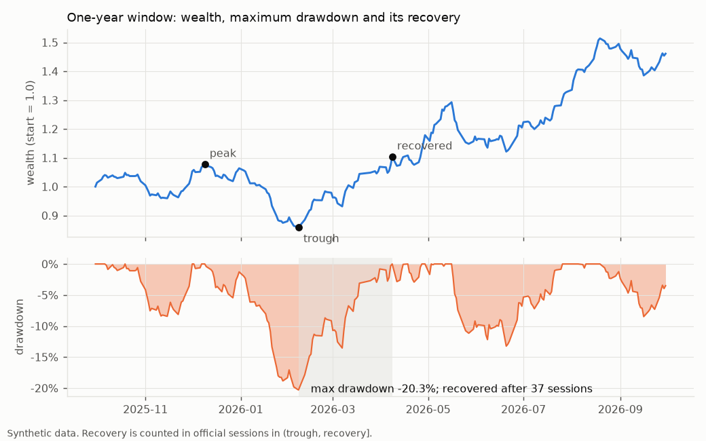
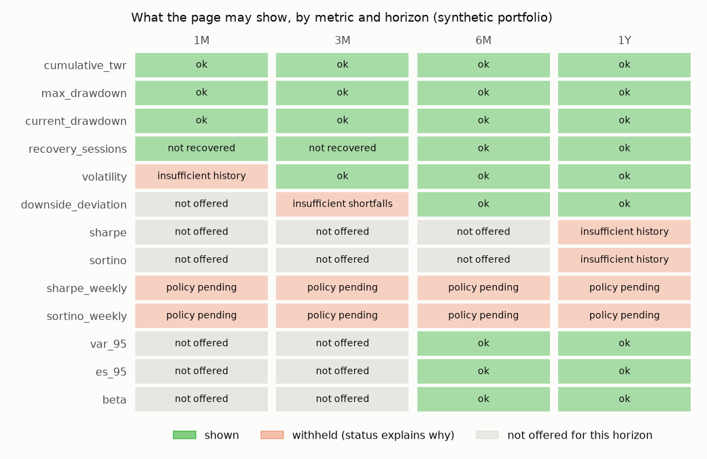
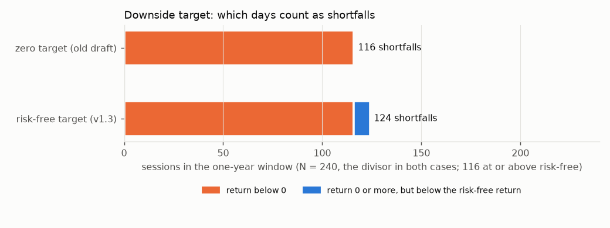

# Portfolio Risk Metrics


Historical risk measures for a retail investor's portfolio page, computed from a daily
time-weighted return (TWR) series: volatility, downside deviation against the risk-free rate,
Sharpe and Sortino, maximum and current drawdown, recovery time in market sessions, and
(as extensions) historical VaR, expected shortfall and beta. Every result comes with an
explicit status and reasons, and every rule lives in one versioned methodology contract.

**Portfolio context.** This personal reference implementation demonstrates financial
Product Owner work: explicit methodology, edge cases, data contracts, acceptance criteria
and reproducible synthetic examples. It is an educational reconstruction, not employer
source code or a statement of deployed behaviour. Financial policies and thresholds in this
repository are local demonstration choices. No production scale, release outcome or
organizational approval is claimed.

**Portfolio analytics chain.** [Portfolio Data Quality](https://github.com/Amir-Shokat/portfolio-data-quality)
validates upstream evidence, the [Portfolio Return Engine](https://github.com/Amir-Shokat/portfolio-return-engine)
produces the daily TWR used here, and [Return Monitoring](https://github.com/Amir-Shokat/return-monitoring)
supervises production completeness and anomalies.

## What's inside

| Module | Contents |
|---|---|
| `metrics` | pure formulas: wealth index, cumulative return, drawdown series, max drawdown (with tie flag), volatility, downside deviation with risk-free target, Sharpe, Sortino, historical VaR and ES, beta; raises `Undefined` with a reason instead of returning 0 or NaN |
| `riskfree` | Treasury-bill YTM to per-session risk-free return, `(1 + YTM) ** (1/250) - 1`; declared units only |
| `inputs` | CSV readers and the input contract; window building on the official calendar (missing vs not computed vs zero, holidays, closed-day rows, month-end clamping) |
| `recovery` | window-bound recovery of the max drawdown, counted in official sessions in `(trough, recovery]` |
| `weekly` | weekly Sharpe and Sortino (`sqrt(52)`) from compounded weekly returns and weekly risk-free returns; partial weeks reported |
| `eligibility` | history gates, reason codes, status precedence, calculation and publication views |
| `contract` + `methodology.json` | the versioned methodology contract, whole-document and per-metric fingerprints |
| `versioning` | result keys, change-impact map, a result store that supersedes but never overwrites |
| `report`, `cli` | `assess()` for one horizon; `portfolio-risk` command (table or JSON) |

## Quick start

```bash
git clone https://github.com/Amir-Shokat/portfolio-risk-metrics.git
cd portfolio-risk-metrics
pip install -e ".[dev]"            # add ",charts" to redraw the PNGs
pytest                             # 72 tests

portfolio-risk --returns examples/daily_returns.csv --rf examples/tbill_ytm.csv \
    --calendar examples/trading_days.csv --market examples/market_index.csv --horizon 1Y
portfolio-risk ... --horizon ALL --json --diagnostics     # every horizon, with withheld values
```

```python
from portfolio_risk import load_inputs, assess
inputs = load_inputs("examples/daily_returns.csv", "examples/trading_days.csv",
                     "examples/tbill_ytm.csv", "examples/market_index.csv")
report = assess(inputs, horizon="1Y")
report["sharpe"].status, report["sharpe"].reasons, report["sharpe"].diagnostic
report["recovery_sessions"].details        # peak, trough and recovery dates
```

## Example output

One year of the synthetic portfolio (no dependencies beyond the standard library):

```
Portfolio risk report  |  methodology 1.3  |  contract 619440776d24
policies: history=single-gate-v1  ratio_history=250obs-v1  downside=rf-target-v1  recovery=1.1-window-bound-session-count  weekly=weekly-ratios-v1  extensions=toolkit-ext-v1
horizon 1Y: sessions after 2025-09-30 up to 2026-09-30  (current window)
official sessions 258  valid 256  not computed 2  missing 0  rf aligned 256

metric                   value  status                      n  short  reasons
-----------------------------------------------------------------------------
cumulative_twr          74.28%  OK                        256
max_drawdown           -13.86%  OK                        256
current_drawdown        -3.25%  OK                        256
recovery_sessions           25  OK                        256
volatility              17.63%  OK                        256
downside_deviation      11.35%  OK                        256    114
sharpe                    1.65  OK                        256
sortino                   2.56  OK                        256    114
sharpe_weekly                -  POLICY_PENDING             51         WEEKLY_POLICY_PENDING
sortino_weekly               -  POLICY_PENDING             51     21  WEEKLY_POLICY_PENDING
var_95                   1.58%  OK                        256         EXTENSION_METRIC
es_95                    2.13%  OK                        256         EXTENSION_METRIC
beta                      0.90  OK                        256         EXTENSION_METRIC
```

The ratio lookback policy is explicit. With `--ratio-lookback last_n`, ratios use the latest
250 valid sessions instead of silently changing the selected horizon:

```
sharpe                    1.65  OK                        250         RATIO_LOOKBACK_LAST_N
sortino                   2.56  OK                        250    111  RATIO_LOOKBACK_LAST_N
```

<p> </p>
<p></p>

## Design decisions

| Question | Decision | Why |
|---|---|---|
| What is the input? | Daily cash-flow-adjusted TWR, not balances or trades | Risk should describe the portfolio, not when the investor deposited money |
| Annualisation | Fixed `sqrt(250)` for every horizon and user | Comparable numbers; the factor is a convention, never the user's row count |
| Risk-free rate | Treasury-bill YTM, `(1 + YTM) ** (1/250) - 1` per session, same-date quote | Consistent with the factor; an ACT/365 draft gave a Saturday three days of interest |
| Downside target | The same session's risk-free return, not zero | A +0.05% day when T-bills pay 0.10% is still a shortfall (124 shortfalls instead of 116 in the example) |
| Downside divisor | N = all aligned observations | Dividing by the shortfall count overstates downside risk |
| Sharpe denominator | SD of excess returns | Differs from the SD of raw returns when the risk-free rate moves |
| Missing data | Missing session blocks the window; `not_computed` excluded and reported; holidays not padded | A filled-in zero makes risk look smaller than it is |
| Minimum history | One gate per metric (20 / 30 / 30 + 30 shortfalls / 250), inclusive, no elapsed-day gate | Two-tier "limited/standard" labels confused users and engineers |
| Undefined values | `None` + `UNDEFINED`, never 0 or infinity; input problems outrank history gates | An undefined ratio must not look like a young account |
| Recovery | Searched only inside the window; official sessions in `(trough, recovery]`; "not recovered" is not 0 | A past period's answer must not change when new data arrives |
| Weekly ratios | Formulas specified locally, `sqrt(52)`, weekly rf compounds daily rf; published as `POLICY_PENDING` | The week boundary and weekly minimum history were not approved, so the code does not invent them |
| Change control | Versioned JSON contract, per-metric fingerprints, results superseded not overwritten | A changed drawdown gate must not invalidate cached Sharpe ratios; support must reproduce old numbers |

## Documentation

- [docs/methodology.md](docs/methodology.md): every formula, unit, target and convention
- [docs/eligibility-and-statuses.md](docs/eligibility-and-statuses.md): gates, reason codes, status precedence
- [docs/data-and-calendar.md](docs/data-and-calendar.md): input files, official calendar, missing vs not computed vs zero
- [docs/decisions.md](docs/decisions.md): decision log
- [docs/change-process.md](docs/change-process.md): how a methodology change is approved and rolled out
- [docs/acceptance-criteria.md](docs/acceptance-criteria.md) and [docs/features/](docs/features): acceptance criteria and Gherkin scenarios, each mirrored by a test
- [docs/open-questions.md](docs/open-questions.md): what was deliberately left undecided, and the safe default used

## License

MIT
